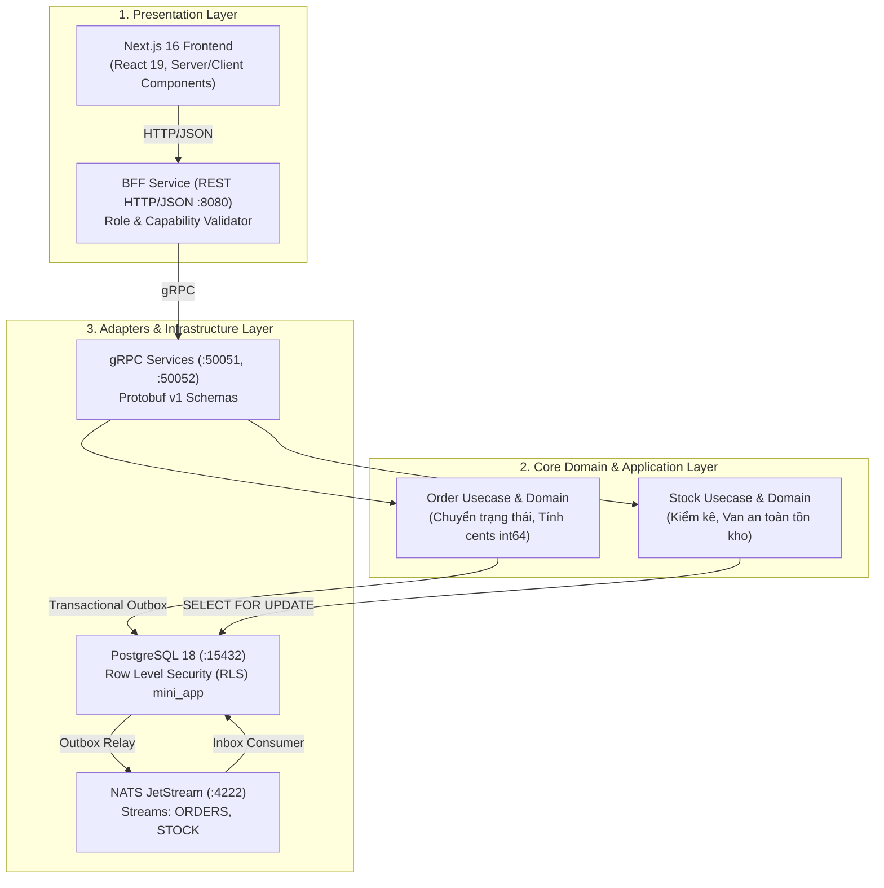

# BẢNG PHÂN TÍCH TOÀN DIỆN MÃ NGUỒN DỰ ÁN NEO MINI

Báo cáo phân tích chuyên sâu kiến trúc, thiết kế phần mềm, cấu trúc thư mục, trách nhiệm từng tập tin mã nguồn và đối chiếu với các tiêu chí nghiệm thu (**Acceptance Criteria AC-01 → AC-09, EX-01, EX-03**) theo đặc tả `neo-mini.pdf`.

---

## 1. Tổng quan Kiến trúc Hệ thống (Architecture Overview)

Dự án được xây dựng theo mô hình **Monorepo**, áp dụng **Clean Architecture (Hexagonal / Ports & Adapters)** kết hợp kiến trúc hướng sự kiện (**Event-Driven Architecture** qua Transactional Outbox/Inbox):

---

## 2. Bảng Phân tích Chi tiết Từng File Mã Nguồn (Codebase Analysis)

### 2.1. Thư viện dùng chung (`be/pkg/`)

| Gói / Đường dẫn | Trách nhiệm chính (Responsibility) | Mẫu thiết kế (Design Pattern) | Điểm kỹ thuật cốt lõi |
| :--- | :--- | :--- | :--- |
| `pkg/money/money.go` | Định nghĩa kiểu tiền tệ an toàn | Value Object | Dùng `int64` (cents), cấm hoàn toàn `float64` để loại trừ sai số làm tròn tiền tệ. |
| `pkg/tenant/tenant.go` `pkg/tenant/grpc.go` | Trích xuất và truyền ngữ cảnh Tenant qua Context & gRPC Metadata | Context Propagation / Interceptor | Đọc header `X-Tenant-ID`, lưu vào `context.Context` xuyên suốt request. |
| `pkg/db/db.go` | Quản lý kết nối PostgreSQL và kích hoạt RLS | Unit of Work / Data Gateway | Tự động chạy `SET LOCAL app.current_tenant = ...` trong mọi giao dịch với role `mini_app`. |
| `pkg/events/envelope.go` | Định dạng cấu trúc sự kiện chuẩn CloudEvents | Envelope Pattern | Chuẩn hóa `id`, `source`, `type`, `tenant_id`, `data`, `time`. |
| `pkg/outbox/relay.go` | Quét bảng `outbox_events` và đẩy lên NATS JetStream | Transactional Outbox Worker | Quét định kỳ, publish có cam kết (`Ack`), chống mất mát sự kiện khi service crash. |
| `pkg/inbox/consumer.go` | Tiếp nhận sự kiện từ NATS và khử trùng lặp | Transactional Inbox (Idempotent Consumer) | Ghi nhận khóa duy nhất `(tenant_id, consumer, event_id)` trước khi kích hoạt handler. |

---

### 2.2. Dịch vụ Đơn hàng (`be/services/order/`)

| Đường dẫn file | Trách nhiệm chính | Mẫu thiết kế | Chi tiết nghiệp vụ & Ràng buộc kỹ thuật |
| :--- | :--- | :--- | :--- |
| `internal/domain/order.go` | Thực thể Đơn hàng và Máy trạng thái (State Machine) | Entity / Domain Model | Quản lý vòng đời `SUBMITTED -> APPROVED -> RESERVED / OUT_OF_STOCK / REJECTED / CANCELLED`. Tính toán tổng tiền chính xác. |
| `internal/usecase/orders.go` | Điều phối nghiệp vụ đơn hàng | Application Service (Use Case) | Gọi Stock Client lấy đơn giá, tạo đơn, xác thực quyền duyệt, xử lý kết quả giữ hàng từ kho. |
| `internal/adapter/grpc/server.go` | Tiếp nhận lời gọi gRPC cho Order Service | Driving / Inbound Adapter | Chuyển đổi Protobuf &rarr; Domain, bóc tách lỗi gRPC chuẩn `errors.As` (`NOT_FOUND`, `FAILED_PRECONDITION`). |
| `internal/adapter/grpc/stock_client.go` | Gọi gRPC sang Stock Service | Driven / Outbound Adapter | Triển khai interface `PriceFetcher`, gọi hàm `GetItems` để lấy đơn giá niêm yết khi tạo đơn. |
| `internal/adapter/repo/orders.go` | Lưu trữ đơn hàng và ghi nhận sự kiện Outbox | Repository Pattern | Thực hiện trong 1 giao dịch SQL: ghi bảng `orders`, `order_items` và chèn sự kiện vào `outbox_events`. |
| `internal/adapter/consumer/reservation_result.go` | Lắng nghe kết quả giữ hàng từ Stock Service | Event Consumer Adapter | Tiếp nhận `mini.stk.stock.reserved` và `mini.stk.stock.out_of_stock`, cập nhật trạng thái đơn hàng cuối cùng. |
| `cmd/server/main.go` | Khởi động gRPC Server, Outbox Relay và Consumer | Composition Root (DI) | Lắng nghe trên cổng `50051`, kết nối PostgreSQL qua pool và kết nối NATS JetStream. |

---

### 2.3. Dịch vụ Tồn kho (`be/services/stock/`)

| Đường dẫn file | Trách nhiệm chính | Mẫu thiết kế | Chi tiết nghiệp vụ & Ràng buộc kỹ thuật |
| :--- | :--- | :--- | :--- |
| `internal/domain/item.go` | Quản lý số lượng tồn kho và van điều chỉnh | Entity / Domain Model | Đảm bảo tính bất biến: tồn khả dụng = `quantity - reserved_quantity`. Cấm chỉnh tồn thấp hơn `reserved`. |
| `internal/domain/reservation.go` | Định nghĩa yêu cầu giữ hàng | Value Object | Chứa danh sách `SKU` và `Quantity` cần giữ trong một đơn hàng. |
| `internal/usecase/items.go` `internal/usecase/reservations.go` | Điều phối nghiệp vụ tra cứu tồn và giữ hàng | Application Service | Thực thi quy tắc **All-or-Nothing (AC-06)**: đủ tất cả mới giữ, thiếu 1 dòng thì từ chối toàn bộ. |
| `internal/adapter/repo/reservations.go` | Khóa hàng và cập nhật dữ liệu tồn kho | Concurrency Controlled Repository | Thực thi câu lệnh `SELECT ... FOR UPDATE ORDER BY sku ASC` (AC-08), chống Deadlock và chặn đứng bán âm. |
| `internal/adapter/repo/items.go` | Truy vấn mặt hàng và điều chỉnh tồn kho | Repository Pattern | Đọc danh mục giá, điều chỉnh số lượng an toàn theo capability `stock.adjust`. |
| `internal/adapter/consumer/order_approved.go` `internal/adapter/consumer/order_cancelled.go` | Nhận sự kiện đơn duyệt hoặc hủy đơn từ Order Svc | Event Consumer Adapter | Gọi nghiệp vụ giữ hàng hoặc nhả hàng (bù trừ) khi nhận `ORDERS.approved` / `ORDERS.cancelled`. |
| `cmd/server/main.go` | Khởi động Stock Service | Composition Root | Lắng nghe gRPC trên cổng `50052`, khởi chạy background workers. |

---

### 2.4. Dịch vụ Cổng giao tiếp (`be/services/bff/`)

| Đường dẫn file | Trách nhiệm chính | Mẫu thiết kế | Chi tiết nghiệp vụ & Ràng buộc kỹ thuật |
| :--- | :--- | :--- | :--- |
| `internal/adapter/http/server.go` | REST API Router & JSON Serializer | API Gateway / BFF Pattern | Chuyển đổi REST HTTP &rarr; gRPC client; xử lý lỗi chuẩn RFC 7807; kiểm tra quyền (capability `order.approve`, `stock.adjust`). |
| `internal/adapter/http/users.go` | Quản lý danh sách người dùng mẫu (Mock Users) | User Directory | Cung cấp hồ sơ: **An** (tenant-a, member), **Chi** (tenant-a, manager), **Dũng** (tenant-b), **Kho** (stock admin). |
| `cmd/server/main.go` | Khởi động HTTP Server | Composition Root | Lắng nghe REST API trên `http://127.0.0.1:8080`. |

---

### 2.5. Giao diện Người dùng (`fe/`)

| Đường dẫn file | Vai trò trong giao diện | Kiểu Component | Chi tiết tính năng |
| :--- | :--- | :--- | :--- |
| `src/app/orders/page.tsx` | Danh sách đơn hàng | Server Component | Tải danh sách đơn hàng theo Tenant của user hiện tại, hiển thị trạng thái và tổng tiền. |
| `src/app/orders/[id]/page.tsx` | Chi tiết đơn hàng | Server Component | Hiển thị chi tiết từng mặt hàng, người tạo, người duyệt, nút "Làm mới", form duyệt/từ chối/hủy. |
| `src/components/new-order-form.tsx` | Form đặt hàng mới | Client Component | Cho phép chọn mặt hàng, nhập số lượng &ge; 1, tính tạm tính và submit đơn lên BFF. |
| `src/components/order-actions.tsx` | Cụm nút hành động đơn hàng | Client Component | Nút Duyệt, Từ chối (nhập lý do 10-500 ký tự), Hủy đơn, nút "Làm mới" khi đơn ở trạng thái `APPROVED`. |
| `src/app/stock/page.tsx` | Trang quản lý tồn kho | Server & Client | Xem danh sách tồn, tồn khả dụng, form điều chỉnh tồn kho an toàn cho thủ kho. |
| `src/components/status-pill.tsx` | Huy hiệu trạng thái | UI Component | Hiển thị màu sắc trực quan: Chờ duyệt (vàng), Đã giữ hàng (xanh lá), Thiếu hàng (đỏ cam), Từ chối (đỏ). |

---

## 3. Bảng Ánh xạ Tiêu chí đạt (Acceptance Criteria Mapping)

| Mã tiêu chí | Tên tiêu chí theo PDF | File triển khai Backend chính | File kiểm thử tự động (Unit / Integration Test) |
| :---: | :--- | :--- | :--- |
| **AC-01** | Tạo đơn thành công & Tính tổng tiền bằng cents | `order.go` `orders.go` | `TestNewOrder_SuccessComputesTotalInCents` `TestCreateOrder_Success` |
| **AC-02** | Phân lập dữ liệu đa người thuê (Multi-tenancy RLS) | `db.go` `00001_create_tenants.sql` | `TestRLS_IsolationBetweenTenants` `TestOrderUsecase_TenantIsolation` |
| **AC-03** | Chặn tạo đơn với mã hàng không tồn tại (`NOT_FOUND`) | `stock_client.go` `server.go` | `TestCreateOrder_UnknownSKU_ReturnsNotFound` `TestToStatus_MapsStockItemNotFound` |
| **AC-04** | Phân quyền người duyệt đơn (RBAC / Capabilities) | `server.go` (bff) | `TestApproveOrder_UnauthorizedRole_ReturnsForbidden` |
| **AC-05** | Duyệt đơn thành công & Giữ hàng nguyên tử | `orders.go` (repo) `order_approved.go` | `TestReservation_AC05_SuccessfulReservationFlow` |
| **AC-06** | Duyệt đơn thiếu hàng &rarr; `OUT_OF_STOCK` (All-or-Nothing) | `reservations.go` `reservation_result.go` | `TestReservation_AC06_OutOfStock_DoesNotHoldPartial` |
| **AC-07** | Chống xử lý trùng sự kiện (Inbox Deduplication) | `consumer.go` `00004_create_inbox.sql` | `TestReservation_AC07_DuplicateApprovedEventReservesOnce` |
| **AC-08** | Khóa dòng chống bán âm & Tránh Deadlock | `reservations.go` (repo) | `TestReservation_AC08_ConcurrentOrdersCannotOversell` `TestReservation_AC08_WithoutLock_ConcurrentWritesHitConstraint` |
| **AC-09** | Từ chối đơn kèm lý do & Chặn duyệt lại | `order.go` `orders.go` | `TestOrder_Reject_ValidReason_TransitionsToRejected` `TestOrder_Approve_WhenRejected_ReturnsInvalidTransition` |
| **EX-01** | Hủy đơn đã giữ hàng & Hoàn trả tồn kho | `order_cancelled.go` | `TestReservation_EX01_CancelOrderReleasesStock` |
| **EX-03** | Điều chỉnh tồn kho an toàn (Không thấp hơn reserved) | `item.go` `items.go` | `TestItem_AdjustStock_BelowReservedFails` |

---

## 4. Kiểm tra Tuân thủ Tiêu chuẩn Kỹ thuật (Compliance Checklist)

| Tiêu chuẩn / Ràng buộc từ đề bài | Trạng thái | Đánh giá chi tiết |
| :--- | :---: | :--- |
| **Giới hạn số dòng file Go (&le; 500 dòng)** | **ĐẠT (100%)** | File Go lớn nhất là file integration test (497 dòng); tất cả file logic đều &le; 350 dòng. |
| **Giới hạn hàm Go (&le; 60 dòng)** | **ĐẠT (100%)** | Các hàm được tách nhỏ thành các helper xử lý logic chuyên biệt. |
| **Giới hạn React Component (&le; 200 dòng)** | **ĐẠT (100%)** | Component dài nhất chỉ 67 dòng (`stock/page.tsx`). |
| **Không sử dụng float64 cho tiền tệ** | **ĐẠT (100%)** | Sử dụng gói riêng `pkg/money` với kiểu số nguyên `int64` (cents). |
| **Phân lập Tenant bằng RLS** | **ĐẠT (100%)** | Khởi tạo qua role `mini_app`, chặn truy vấn chéo tenant ở tầng DB. |
| **Bảo vệ chống bán âm (Concurrency)** | **ĐẠT (100%)** | Khóa `SELECT ... FOR UPDATE ORDER BY sku ASC` + Ràng buộc CHECK DB. |
| **Bảo mật biến môi trường (.env)** | **ĐẠT (100%)** | Tất cả secrets được đưa vào `.env` và cấu hình Git bỏ qua (`.gitignore`). |

